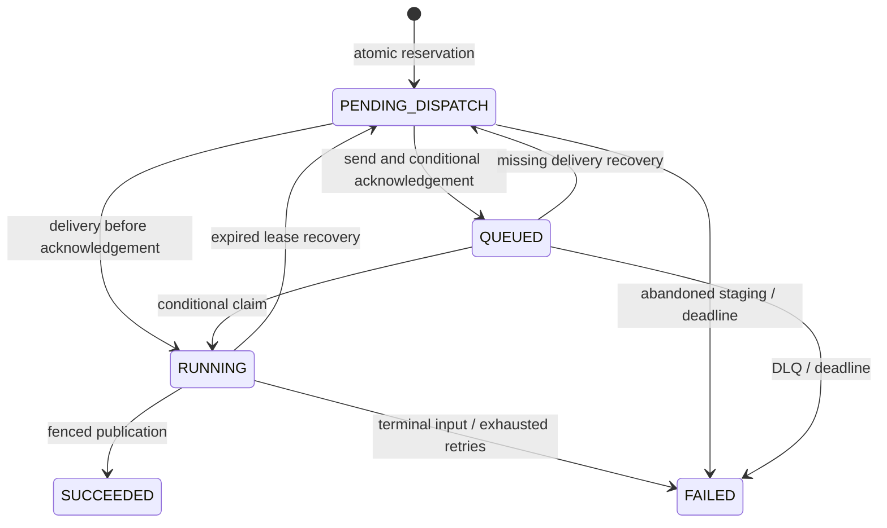

# Asynchronous saved analysis

Implemented on `feature/milestone-3-async-analysis`, October 26, 2026. The scoped IAM update and
AWS test deployment and browser acceptance completed November 7. See
[live acceptance](TESTING.md#november-7-2026-milestone-3-rollout) for the results.
This extends learning and burst handling; it does not establish that the analyzer needs a queue.

## API and user workflow

| Method | Route | Response |
| --- | --- | --- |
| POST | `/projects/:projectId/runs/async` | `202 {run}` after staging input and persisting dispatch intent |
| GET | `/projects/:projectId/runs/:runId/status` | Owner-authorized public run metadata, including job status |
| POST | `/projects/:projectId/runs/:runId/retry` | `202 {run}` for a linked new run; failed parent and reuploaded inputs required |

Submission and retry accept the same `{input, idempotencyKey, retainSource?}` body as synchronous
saves. Browser reports, owner IDs and artifact keys are rejected. All hosted routes use Cognito;
the service constructs owner-scoped keys from the trusted subject. Responses use `no-store`.
Retrying the same request/key returns the same job, including its terminal failure. A new explicit
retry uses a new key and new run ID with `provenance.kind = retry`; it never reopens the old job.

Project analysis queues by default; uncheck the queue option for synchronous saving. Stateless
analysis, CLI, synchronous saves and validated Apply/reanalysis remain available. History includes
pending and failed jobs. Opening a job URL polls status at 2, 4, 8, 16, then 30 seconds, stops at a
terminal state, and cancels polling on navigation. Refresh/fresh sessions restore from the URL and
API. Only successful jobs enable report access and comparison. Failed jobs link to explicit reupload.
Fully local Express uses in-memory queued delivery/recovery without AWS; restarting that local
process loses memory history, as before. Persistent refresh/return behavior requires AWS storage.

## State, dispatch and publication

The API atomically reserves project/user run counts, a pending-job slot, an owner-scoped idempotency
key and a run with dispatch intent. Default pending quota is five per user
(`INFRALENS_QUOTA_PENDING_JOBS_PER_USER`); existing project/run/input/save-key quotas still apply.
Legacy owner rows start with zero pending jobs. Completion, visible failure and deletion release
the pending slot transactionally and exactly once.

The run contains a durable staging manifest before S3 writes. Its unique `job-input.json` key pins
canonical normalized input bytes and a SHA-256 digest. Retries can write only the identical bytes
before readiness; workers verify the digest and compare all queue references against durable
metadata. No signed upload capability is introduced. Queue messages contain only owner/project/run
IDs, an artifact key and digest, never raw template/source. The worker does not trust a queued key
without checking the stored manifest.

Only a ready input receives `202`. A failed upload/readiness write is retryable using the same key;
an abandoned reservation becomes a visible dispatch failure. API-side send/acknowledgement failures
leave accepted intent discoverable. A worker can claim before the send acknowledgement, and a
conditional version check prevents that acknowledgement from rolling the state back to QUEUED.

Claims allocate a random attempt/fencing token, immutable attempt-specific output keys and a
120-second lease. Worker Lambda timeout is 60 seconds, so cleanup/takeover waits beyond its hard
lifetime. Staging reservations similarly outlive the API's 30-second hard lifetime. Publication
requires the same record version/token, an unexpired lease, an active project/run and, for a retry,
an undeleted parent in the same transaction. Only one attempt can publish. A stale worker may
write its own unpublished objects but cannot replace the winning pointers or report. Every attempt's
object keys are recorded before writing, including losing/partial output, so cleanup can find them.
The source and report remain server-generated; analyzer `0.2.0` and report schema `2` are unchanged
because this changes job metadata/transport, not analyzer behavior or report format.

Infrastructure/storage failures leave the claim for delivery/recovery. Invalid input and digest
mismatch fail terminally. Application attempts are bounded at three; job lifetime is 30 minutes.
Failure codes are safe categories, never raw exception messages or uploaded contents. SUCCEEDED
means analysis produced a report, not that the analyzed architecture has no risks or has been deployed.

## Recovery and deletion

The runs table has a sparse `JobRecovery` GSI: four fixed `JOB#0`–`JOB#3` partitions and numeric
`recoveryAt` sort keys. Every two minutes, a separate recovery Lambda queries at most 25 due rows
per shard (100 total). It follows each eventual GSI row with a strongly consistent primary-key read
and conditional writes; old index entries cannot change a newer claim/result. No Scan or owner
enumeration is used. Pending intent persists independently of SQS/stream retention. Failed
operations rotate their due time so one bad job cannot monopolize a shard; the invocation reports
failure after processing other due jobs, feeding the recovery error alarm. A timeout leaves all
uncompleted work discoverable for the next scheduled pass.

Recovery resends missing dispatch/delivery, fences expired claims, and exposes abandoned inputs,
exhausted attempts/deadlines and recognized DLQ jobs as failures. The recovery role drains at most
10 DLQ messages per pass and acknowledges them only after durable reconciliation. A DLQ message
with an active claim waits for that lease; unrecognized/malformed messages remain for investigation.
Transient failures can delay recovery; this is at-least-once processing with one published result,
not exactly-once execution.

Raw execution source is temporary even without retention opt-in. It is never returned by status,
open, download or retry. After a job finishes and all writer leases expire, recovery removes staging
and losing/failed attempt artifacts; the sparse index entry is removed only after cleanup succeeds.
S3's seven-day input lifecycle is a fallback, not the access-control clock. Successful retained
inputs still expire seven days after submission; source is included only with opt-in. No source
is reconstructed from saved evidence. Legacy reports, unknown versions, comparison source
independence and synchronous history behavior remain unchanged.

Deleting an active run/project closes access immediately. Worker publication includes project/run
and linked-parent conditional checks. Deletion releases quotas and preserves tombstones/manifests;
physical cleanup waits for leases and retries failures. Async tombstones remain in the recovery
index until artifacts are removed. Existing owner cleanup skips live async jobs and still handles
legacy abandoned synchronous saves. Deleting a failed parent prevents publication of its retry;
the child becomes a visible PARENT_DELETED failure instead of holding a pending slot forever.

## Infrastructure and operating runbook

- Private SQS standard queue: SSE-SQS, TLS-only policy, four-day retention, 360-second visibility,
  DLQ after five receives. DLQ: SSE-SQS, TLS-only, 14-day retention. Queues retain on stack removal.
- Separate API, worker and recovery roles. API sends only; worker consumes only. Worker concurrency
  is capped at two by the SQS event source mapping, with batch size one and partial batch failures enabled.
  Both functions use shared account concurrency. The test quota is 10, with no capacity for reservations.
  Recovery runs every two minutes with a 60-second timeout and bounded queries. Conditional writes handle overlapping retries.
  Metadata and artifact grants are scoped to the existing tables/index and owner artifact prefix.
- Queue age/depth and DLQ alarms, plus worker/recovery Lambda error alarms, join existing alerts.
  SQS partial failures do not increment Lambda Errors themselves; queue/DLQ/status provide
  complementary evidence. Subscription delivery still depends on the configured alert email.
- Queue visibility follows AWS's [SQS/Lambda configuration guidance](https://docs.aws.amazon.com/lambda/latest/dg/services-sqs-configure.html)
  and [partial batch response contract](https://docs.aws.amazon.com/lambda/latest/dg/services-sqs-errorhandling.html).

No AWS operation is authorized by this document. Before a separately authorized test deployment,
verify caller account `230944684535`, region `eu-central-1`, persistent `InfraLensTestStack` and scoped
profiles using the existing guarded workflows. Preserve `InfraLensTestScopedV1`, qualifier
`hnb659fds`, bootstrap version 32 and the administrator-owned application boundary. The currently
recorded milestone 2 permission package does **not** yet cover these new services. Review a fresh
read-only bootstrap/policy snapshot and prepare a narrow permission update before deployment:

| Area | Required review |
| --- | --- |
| Application boundary | SQS send/consume grants on the two test queue name prefixes and only the intended role prefixes. The existing runs-table ARN wildcard covers the recovery index; the recovery role's inline policy grants Query on that index. |
| CloudFormation execution | Provision/update/tag the two test queues and TLS policies, two extra Lambda functions/concurrency, one event-source mapping and the scheduled EventBridge rule/target. Scope to test resource prefixes, function/source conditions where supported and existing region/account boundaries. |
| Lambda invocation | Scheduled rule invocation permission on recovery; queue mapping permission on worker. Preserve existing role passing restrictions and runtime roles' boundary. |

On November 7, renewed test SSO allowed the
[async policy preparation](TEST_DEPLOYMENT_PERMISSIONS.md#milestone-3-async-analysis-permissions)
to run against the live bootstrap. Access Analyzer reported no findings. The three-resource change
set and the scoped test backend update reached `UPDATE_COMPLETE`. Do not rerun old
bootstrap repair procedures or default bootstrap. Production remains deferred. After reviewing
permissions and the guarded test diff (including the additive GSI backfill and regional Lambda
concurrency availability), deploy backend first, then publish frontend through its separate profile.
No persistent tables/buckets or existing history should be replaced.

For recovery incidents, inspect safe status/attempt metadata, queue age/depth/DLQ and worker/recovery
alarms first. Restore worker/storage/send permissions or availability before redriving. For a known
nonterminal job, an explicitly authorized operator redrive to the same source queue can duplicate
delivery safely; durable metadata remains authoritative. Redriving a terminal job does not reopen it.
For a failed job, use the UI reupload/retry action to create a linked new run. Preserve unknown DLQ
messages and investigate their provenance; never paste raw inputs/tokens into logs or chat. Avoid
manual state edits that bypass fencing, quotas or deletion. Keep the persistent test stack deployed.

Milestone 4 can replace direct sending with Streams while reusing the durable intent, worker
idempotency and bounded recovery path. Time-bucketed indexing, staged browser uploads and Scheduler
cleanup/checkpoint refinements remain milestone 4 work.

## Verification evidence

October 26 final offline verification: **635 Mocha/Chai tests passed**, all workspace typechecks
and builds passed, including CDK synthesis/resource assertions. Initial Vite JavaScript is about
247 kB without a chunk-size warning. The first sandbox run was restricted by localhost/temporary
directory/symlink permissions; rerunning the offline checks with those local permissions passed.

`apps/api/test/asyncAnalysis.integration.test.ts` runs a small deterministic workload with a fake
clock and injected queue/storage failures. It exercises actual server analysis, Lambda routing,
fresh web clients and the storage state machine. It covers duplicate delivery, missed sends,
acknowledgement races, worker crashes, stale fencing, invalid/poison input, DLQ handling, linked
retries, quotas/races, staging/partial writes, retention, parent/project deletion and cleanup recovery.
Resumed staging uploads renew their writer lease before writing; a paused reupload/delete race
verifies that cleanup waits and removes objects written by the losing API invocation.
`analysisQueue.test.ts` verifies SQS send/drain and DynamoDB due-query command boundaries.
CDK assertions verify resources, scoped roles, protected routes, schedules, limits and alarms.

On November 7, all six guarded live storage tests passed against the test deployment. The deployed
scheduler and SQS worker recovered missed sends and an expired claim. A worker using live DynamoDB
and S3 could not publish after project deletion. Signed-in browser checks covered refresh, linked
retry, report isolation for two users, and retained-source comparison and Markdown export. DLQ
reconciliation remains covered by the offline workload. The guarded authenticated HTTP suites
were unrun locally. See [rollout evidence](TESTING.md#november-7-2026-milestone-3-rollout).
